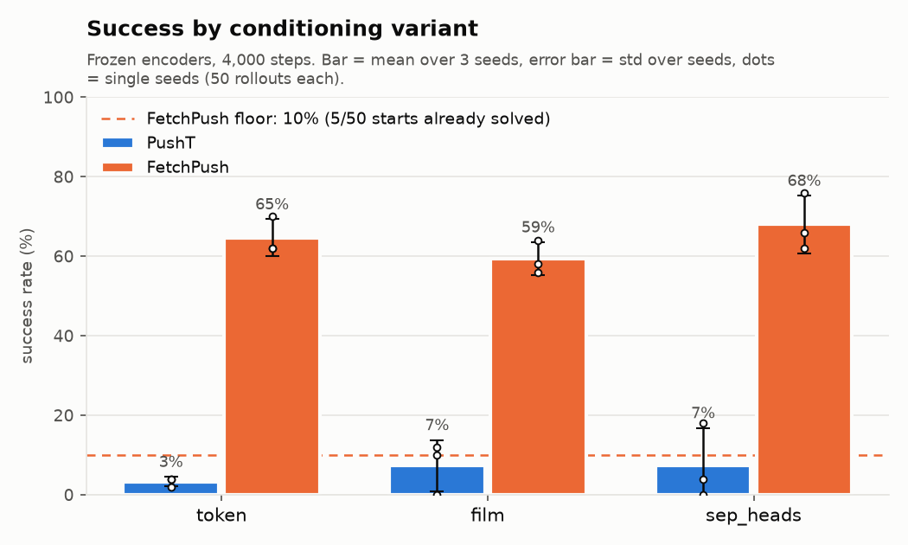
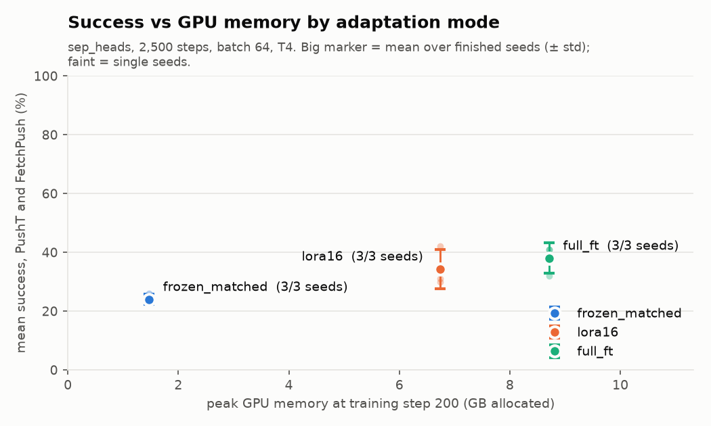
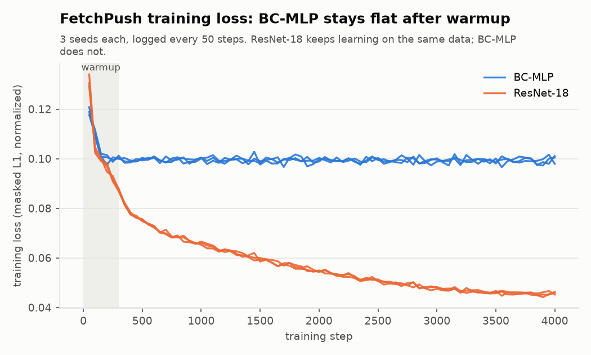
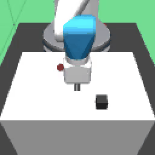
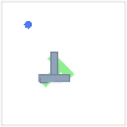

# vla-multiembodiment

One vision-language-action policy for two simulated robots, PushT and FetchPush, with ablations on
how the model is told which robot it controls (learned token, FiLM, separate heads) and on how the
vision encoder is adapted (frozen, full fine-tuning, LoRA). The design is in [docs/spec.md](docs/spec.md).

Results are below, generated by `scripts/aggregate.py`; every number traces to W&B run IDs listed in [results/results.csv](results/results.csv).

<!-- results:start -->
## Results

Generated by `scripts/aggregate.py` on 2026-11-26 14:34 from W&B project `vla-multiembodiment`. Every row lists the W&B run IDs it was computed from; all per-run numbers, commits and links are in [results/results.csv](results/results.csv). Success rates are over 50 rollouts per robot per run from the fixed start seeds 100000–100049. Mean ± std is over training seeds. Per-seed results available for 0 of 30 finished runs.

Run status:
- conditioning: 9 finished (of 9)
- baseline: 12 finished (of 12)
- adaptation: 9 finished (of 9)

### 1. Conditioning variants (frozen encoders, 4,000 steps)

| Variant | Seeds | PushT success (mean ± std) | PushT pooled [95% Wilson] | PushT max coverage | FetchPush success (mean ± std) | FetchPush pooled [95% Wilson] | Mean success |
|---|---|---|---|---|---|---|---|
| token | 3/3 | 3.3 ± 1.2% | 5/150 = 3.3% [1.4, 7.6] | 0.473 ± 0.049 | 64.7 ± 4.6% | 97/150 = 64.7% [56.7, 71.9] | 34.0 ± 2.6% |
| film | 3/3 | 7.3 ± 6.4% | 11/150 = 7.3% [4.1, 12.7] | 0.485 ± 0.073 | 59.3 ± 4.2% | 89/150 = 59.3% [51.3, 66.9] | 33.3 ± 4.7% |
| sep_heads | 3/3 | 7.3 ± 9.5% | 11/150 = 7.3% [4.1, 12.7] | 0.521 ± 0.039 | 68.0 ± 7.2% | 102/150 = 68.0% [60.2, 74.9] | 37.7 ± 8.3% |

Runs (W&B IDs, seeds 0, 1, 2): token: `neo2m4ux`, `vzqwyyqd`, `yf3jvezd` · film: `i0senai6`, `2b1u0h6m`, `houp0iwv` · sep_heads: `m5gn67rl`, `lf76862i`, `rgxuk3g9`

Gaps between variants:

| Pair (A − B) | PushT gap, pp [95% CI] | FetchPush gap, pp [95% CI] | Mean gap, pp [95% CI] | Method | Verdict |
|---|---|---|---|---|---|
| token − film | -4.0 [-10.7, +0.7] | +5.3 [-6.0, +13.3] | +0.7 [-8.0, +6.3] | approx. (5 blocks of 10 starts) | not distinguishable |
| token − sep_heads | -4.0 [-7.3, -0.7] * | -3.3 [-9.3, +2.7] | -3.7 [-7.3, +0.0] | approx. (5 blocks of 10 starts) | excludes 0 on PushT (approx. only: provisional) |
| film − sep_heads | -0.0 [-3.3, +4.0] | -8.7 [-16.0, -0.7] * | -4.3 [-9.0, +1.7] | approx. (5 blocks of 10 starts) | excludes 0 on FetchPush (approx. only: provisional) |

Gaps are A − B in percentage points. The interval is a paired bootstrap (10,000 resamples) over the 50 start seeds that every run shares, pooling the 3 training seeds; `*` = the interval excludes 0. A gap is called real only when the exact (per-seed) interval excludes 0. "approx." = per-seed results were not available, so the bootstrap resamples the 5 blocks of 10 starts printed in each run's console log. With only 5 units that interval is unreliable (too narrow and lumpy), so an approx. `*` is provisional, not a claim. The bootstrap treats the training seeds as fixed: it measures start-state noise, not seed-to-seed noise.

### 2. FetchPush success two ways

5 of the 50 FetchPush start seeds (100004, 100010, 100021, 100036, 100049) begin with the cube already within 5 cm of the target (`scripts/fetch_start_check.py`), so a policy that does nothing scores **10%** (the floor; the random policy's 5 wins are exactly these seeds). The second column counts only the 45 starts per run that are not already solved (a do-nothing policy gets 0% there).

| Configuration | Seeds | Overall, pooled [95% Wilson] | vs 10% floor (pp) | Unsolved starts only, pooled [95% Wilson] |
|---|---|---|---|---|
| token | 3/3 | 97/150 = 64.7% [56.7, 71.9] | +54.7 | 82–97 of 135 (range; needs per-seed data) |
| film | 3/3 | 89/150 = 59.3% [51.3, 66.9] | +49.3 | 74–89 of 135 (range; needs per-seed data) |
| sep_heads | 3/3 | 102/150 = 68.0% [60.2, 74.9] | +58.0 | 87–102 of 135 (range; needs per-seed data) |
| bc_mlp | 3/3 | 15/150 = 10.0% [6.2, 15.8] | +0.0 | 0–15 of 135 (range; needs per-seed data) |
| resnet18 | 3/3 | 77/150 = 51.3% [43.4, 59.2] | +41.3 | 62–77 of 135 (range; needs per-seed data) |
| sep_heads frozen_matched (2500 steps) | 3/3 | 70/150 = 46.7% [38.9, 54.6] | +36.7 | 55–70 of 135 (range; needs per-seed data) |
| sep_heads lora16 (2500 steps) | 3/3 | 89/150 = 59.3% [51.3, 66.9] | +49.3 | 74–89 of 135 (range; needs per-seed data) |
| sep_heads full_ft (2500 steps) | 3/3 | 80/150 = 53.3% [45.4, 61.1] | +43.3 | 65–80 of 135 (range; needs per-seed data) |

Runs: token: `neo2m4ux`, `vzqwyyqd`, `yf3jvezd` · film: `i0senai6`, `2b1u0h6m`, `houp0iwv` · sep_heads: `m5gn67rl`, `lf76862i`, `rgxuk3g9` · bc_mlp: `lv456bp9`, `qvkm8zhp`, `4g9gno56` · resnet18: `4i1b97s2`, `3oja5t5i`, `nbzs4vx7` · sep_heads frozen_matched (2500 steps): `516mcmj3`, `981owyth`, `cw33zzpp` · sep_heads lora16 (2500 steps): `8z9ys2qa`, `it8rjzpp`, `qti0vdx9` · sep_heads full_ft (2500 steps): `rje18trq`, `68prcuw5`, `xl5yjno6`

### 3. Baselines vs the VLA (4,000 steps each)

Baselines are single-robot specialists (one model per robot); the VLA variants are one model for both robots.

| Model | PushT success (mean ± std) | PushT pooled [95% Wilson] | FetchPush success (mean ± std) | FetchPush pooled [95% Wilson] | FetchPush, unsolved starts |
|---|---|---|---|---|---|
| bc_mlp | 0.0 ± 0.0% | 0/150 = 0.0% [0.0, 2.5] | 10.0 ± 0.0% | 15/150 = 10.0% [6.2, 15.8] | 0–15 of 135 (range; needs per-seed data) |
| resnet18 | 14.7 ± 6.1% | 22/150 = 14.7% [9.9, 21.2] | 51.3 ± 1.2% | 77/150 = 51.3% [43.4, 59.2] | 62–77 of 135 (range; needs per-seed data) |
| VLA token | 3.3 ± 1.2% | 5/150 = 3.3% [1.4, 7.6] | 64.7 ± 4.6% | 97/150 = 64.7% [56.7, 71.9] | 82–97 of 135 (range; needs per-seed data) |
| VLA film | 7.3 ± 6.4% | 11/150 = 7.3% [4.1, 12.7] | 59.3 ± 4.2% | 89/150 = 59.3% [51.3, 66.9] | 74–89 of 135 (range; needs per-seed data) |
| VLA sep_heads | 7.3 ± 9.5% | 11/150 = 7.3% [4.1, 12.7] | 68.0 ± 7.2% | 102/150 = 68.0% [60.2, 74.9] | 87–102 of 135 (range; needs per-seed data) |

Runs: bc_mlp-pusht: `yjo3mrv2`, `lpzemhdh`, `00hbcff9` · bc_mlp-fetch: `lv456bp9`, `qvkm8zhp`, `4g9gno56` · resnet18-pusht: `331zxjun`, `8un5xk7w`, `ijmsr80q` · resnet18-fetch: `4i1b97s2`, `3oja5t5i`, `nbzs4vx7` · VLA token: `neo2m4ux`, `vzqwyyqd`, `yf3jvezd` · VLA film: `i0senai6`, `2b1u0h6m`, `houp0iwv` · VLA sep_heads: `m5gn67rl`, `lf76862i`, `rgxuk3g9`

Gaps between the best VLA variant (sep_heads) and each baseline:

| Pair (A − B) | PushT gap, pp [95% CI] | FetchPush gap, pp [95% CI] | Method | Verdict |
|---|---|---|---|---|
| VLA sep_heads − bc_mlp | +7.3 [+3.3, +10.7] * | +58.0 [+46.7, +70.0] * | approx. (5 blocks of 10 starts) | excludes 0 on PushT, FetchPush (approx. only: provisional) |
| VLA sep_heads − resnet18 | -7.3 [-15.3, -0.7] * | +16.7 [-2.0, +37.3] | approx. (5 blocks of 10 starts) | excludes 0 on PushT (approx. only: provisional) |

Same bootstrap as in table 1.

### 4. Encoder adaptation (sep_heads, 2,500 steps, batch 64)

`frozen_matched` = frozen DINOv2 with the same batch size and steps as the adaptation runs (the fair control). Minutes are wall time per run including evaluation, with two runs sharing the machine (one per T4). Peak GPU memory is allocated memory at training step 200.

| Mode | Seeds | PushT success | FetchPush success | Mean success | % of full_ft (mean) | Peak GPU memory @200 | Minutes per run | Trainable params (DINOv2 + rest) |
|---|---|---|---|---|---|---|---|---|
| frozen_matched | 3/3 | 1.3 ± 1.2% | 46.7 ± 3.1% | 24.0 ± 1.7% | 63% | 1.47 GB | 9.6 | 0 + 14,826,630 |
| lora16 | 3/3 | 9.3 ± 6.4% | 59.3 ± 13.0% | 34.3 ± 6.7% | 90% | 6.73 GB | 30.1 | 442,368 + 14,826,630 |
| full_ft | 3/3 | 22.7 ± 3.1% | 53.3 ± 8.3% | 38.0 ± 5.2% | 100% | 8.71 GB | 29.7 | 22,056,576 + 14,826,630 |

Runs: frozen_matched: `516mcmj3`, `981owyth`, `cw33zzpp` · lora16: `8z9ys2qa`, `it8rjzpp`, `qti0vdx9` · full_ft: `rje18trq`, `68prcuw5`, `xl5yjno6`

LoRA reaches 90% of full fine-tuning's mean success (PushT 41%, FetchPush 111%) with 23% lower peak GPU memory at step 200 (3 and 3 of 3 seeds).

Gaps between adaptation modes:

| Pair (A − B) | PushT gap, pp [95% CI] | FetchPush gap, pp [95% CI] | Mean gap, pp [95% CI] | Method | Verdict |
|---|---|---|---|---|---|
| lora16 − full_ft | -13.3 [-16.0, -10.7] * | +6.0 [+2.0, +10.0] * | -3.7 [-6.3, -1.0] * | approx. (5 blocks of 10 starts) | excludes 0 on PushT, FetchPush, mean (approx. only: provisional) |
| lora16 − frozen_matched | +8.0 [+5.3, +11.3] * | +12.7 [+1.3, +20.7] * | +10.3 [+3.0, +15.0] * | approx. (5 blocks of 10 starts) | excludes 0 on PushT, FetchPush, mean (approx. only: provisional) |
| full_ft − frozen_matched | +21.3 [+18.0, +26.0] * | +6.7 [-5.3, +16.7] | +14.0 [+8.0, +19.7] * | approx. (5 blocks of 10 starts) | excludes 0 on PushT, mean (approx. only: provisional) |

Same bootstrap as in table 1.

Adapted VLA vs the ResNet-18 specialist (ResNet-18: 4,000 steps, batch 128, one robot per model; adapted VLA: 2,500 steps, batch 64, one model for both robots):

| Pair (A − B) | PushT gap, pp [95% CI] | FetchPush gap, pp [95% CI] | Method | Verdict |
|---|---|---|---|---|
| full_ft − resnet18 | +8.0 [-3.3, +16.0] | +2.0 [-14.7, +18.7] | approx. (5 blocks of 10 starts) | not distinguishable |
| lora16 − resnet18 | -5.3 [-14.7, +2.0] | +8.0 [-10.7, +24.0] | approx. (5 blocks of 10 starts) | not distinguishable |

Same bootstrap as in table 1.

### Plots





### Rollouts

These GIFs come from the **best seed of the best variant**: `sep_heads-frozen-s2-75a68d5` (W&B `rgxuk3g9`), seed 2 of sep_heads. They are an illustration, not a typical run: this run scored PushT 9/50 and FetchPush 38/50 (mean 47.0%), while sep_heads averages 37.7% over its seeds. The FetchPush success is on a start that is not already solved.

**PushT success**, start seed 100002 (best seed of the best variant; illustration, not a typical run)


**FetchPush success**, start seed 100001 (best seed of the best variant; illustration, not a typical run)



**PushT failure**, start seed 100000 (best seed of the best variant; illustration, not a typical run)



Findings in plain language: [results/findings.md](results/findings.md). BC-MLP on FetchPush: [results/bc_mlp_fetch.md](results/bc_mlp_fetch.md).
<!-- results:end -->

## Setup on a Mac (CPU-only tests)
```bash
uv venv --python 3.11 .venv
uv pip install --python .venv/bin/python -r requirements.txt
cp .env.example .env        # then paste your W&B key into .env
.venv/bin/python -m pytest -q
```

## Running on Kaggle (GPU)
All data collection, training and evaluation run in a two-cell Kaggle notebook. See
[notebooks/kaggle_cells.md](notebooks/kaggle_cells.md). Available jobs:
`python scripts/kaggle_job.py --list`.
